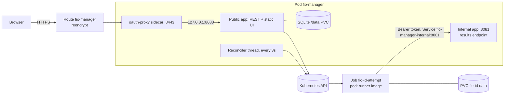
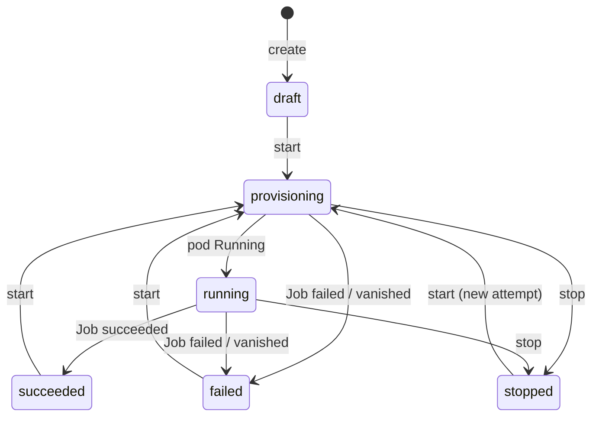

# System patterns

## Architecture

One Python process, two uvicorn servers in one asyncio loop:
- **Public app** (`127.0.0.1:8080`, only reachable through the oauth-proxy sidecar): REST API under `/api`, plus the built React UI with SPA fallback.
- **Internal app** (`0.0.0.0:8081`, Service `fio-manager-internal`): only `POST /internal/runs/{id}/results`, protected by a per-run bearer token. Runner pods call it.

## Authentication: the oauth-proxy sidecar
The FastAPI app has **no login of its own**. The `oauth-proxy` container in the same pod is the only way in (`deploy/openshift.yaml`, container `oauth-proxy`):
- Listens on `:8443` (Service `fio-manager`, Route `reencrypt`) and forwards to `http://127.0.0.1:8080` only after authentication. The manager binds `127.0.0.1` (`FIO_PUBLIC_HOST`), so it cannot be reached around the proxy.
- `--provider=openshift`: the user is redirected to the cluster's OpenShift login. The proxy stores no passwords.
- `--openshift-service-account=fio-manager`: the ServiceAccount is the OAuth client. Its annotation `serviceaccounts.openshift.io/oauth-redirectreference.primary` names the Route to return to after login.
- `--openshift-sar={... "resource":"services","resourceName":"fio-manager","verb":"get"}`: after login the user must be allowed to `get` the Service `fio-manager` in the namespace, otherwise access is denied.
- TLS cert/key come from the Secret `fio-manager-tls`, generated by OpenShift from the annotation `service.beta.openshift.io/serving-cert-secret-name` on the Service.
- `--cookie-secret-file`: signs the session cookie. Secret `fio-manager-proxy` (key `session_secret`) is generated randomly by `deploy/deploy.sh` and `build-and-deploy.sh` on first run. It is never stored in the repo.
- `--skip-auth-regex=^/api/health$`: the only unauthenticated path.
- Not covered by the proxy: the internal port `:8081` (runner results), protected by a per-run bearer token and not exposed by the Route.

### Where the oauth-proxy image comes from
- `image-registry.openshift-image-registry.svc:5000/openshift/oauth-proxy:v4.4` is the cluster's ImageStream `oauth-proxy` in namespace `openshift`, with one tag `v4.4`. On OpenShift 4.21.24 it is owned by the `ClusterVersion` (managed by the Cluster Version Operator) and points to an image of the OpenShift release (`quay.io/openshift-release-dev/ocp-v4.0-art-dev@sha256:...`).
- Decision: keep it. Reasons: the cluster maintains it, the tag is tied to the proxy version, not the OpenShift version, and the manifest does not depend on an external registry.
- Alternative checked and rejected: `quay.io/openshift/origin-oauth-proxy` (public, anonymous pull). Its tags `latest`/`4.21` list only `amd64` (the `4.4` tag is a single manifest, architecture not checked), they are mutable (modified daily), and it has no Red Hat support. This would break the ppc64le and s390x goal of the other images. It was not tested in the cluster. The cluster's own image could not be inspected without the pull secret, so the comparison of contents and architectures is not verified.
- Limits: this dependency only exists on OpenShift. Other OpenShift versions were not checked: run `oc get is oauth-proxy -n openshift` to confirm the tag `v4.4` exists. Red Hat has announced a move away from the OAuth proxy toward external (OIDC) authentication in recent releases (not verified here), so the sidecar may need to be replaced on a future version.
- If a fallback is ever needed: pin the community image by digest, amd64 clusters only, and test it first.

## Code map (`backend/app`)
| File | Role |
|---|---|
| `config.py` | Settings from env vars (`FIO_*`). |
| `models.py` | Pydantic models: `RunSpec`, `Profile`, `Run`, `StorageClassInfo`, `ResultsPush`. Validation lives here. |
| `fio.py` | Presets, job file builder, fio JSON to summary, fio logs to time series. |
| `store.py` | SQLite persistence. Light columns for lists, blobs (`result`, `metrics`, `logs`, `token_hash`) fetched separately. |
| `kube.py` | All Kubernetes calls (StorageClasses, PVC, ConfigMap, Job, pod logs). Raises `KubeError`. |
| `manager.py` | Run lifecycle, the only place that changes run state (API calls and reconciler share it, under one lock). |
| `main.py` | FastAPI apps, error mapping, process entry point. |

API contract: `docs/api.md` (authoritative, the frontend was built against it).

## Run lifecycle

- Active states are `provisioning` and `running`. Editing, deleting and starting an active run returns 409.
- Each start increments `attempt`, uses job name `fio-<id>-<attempt>`, generates a new token (only the SHA-256 hash is stored), and clears previous results.
- The PVC `fio-<id>-data` is created once and reused across attempts. It is recreated if storage class, access mode or size changed.
- The reconciler stores a copy of the pod log when a run finishes or is stopped, so logs survive pod deletion.

## Data flow of results
1. Manager creates ConfigMap `fio-<id>-cfg` with the generated `job.fio`.
2. Runner executes fio with `--output-format=json` and 1-second averaged bw/iops/lat logs.
3. Runner pushes every 5 s `{logs}` (progress, so graphs update live) and finally `{result, logs}`.
4. Manager stores summary, raw JSON and aggregated metrics. fio per-job logs are merged: bw and iops are summed across jobs, latency is averaged.
5. Metrics shape: `{time[], read|write: {iops[], bw_mibs[], lat_us[]}}`.

## Design decisions (with reasons)
| Decision | Reason |
|---|---|
| Python FastAPI + official `kubernetes` client | Requester's choice, fast to build, little work per request. |
| SQLite on a PVC, one replica, `Recreate` strategy | Accepted by requester. Time series do not fit in ConfigMaps and pod logs vanish. |
| Runner pushes results to the manager | No need for the manager to exec into pods or read PVCs. Token per run limits the blast radius. |
| Separate internal port and Service | Keeps the oauth-proxy covering the whole UI/API, while runner pods can still reach the results endpoint. |
| oauth-proxy sidecar with SAR on `get services/fio-manager` | OpenShift-native auth, no auth code in the app. Image comes from the cluster's `openshift/oauth-proxy:v4.4` ImageStream (see "Authentication" above for why, and for the rejected community image). |
| Only allow-listed fio options, job file generated server-side | Prevents injection through free-form fio options. |
| `file_size_gi * numjobs <= 0.9 * pvc_size_gi` | Avoids filling the PVC. |
| Runner pod hardened (non-root, drop ALL caps, seccomp, no SA token) | Works under the default `restricted-v2` SCC for Filesystem mode. |
| Job `backoffLimit: 0`, `activeDeadlineSeconds = runtime + ramp + 1800` | A failed benchmark must not silently retry; a hung one is bounded. |
| NetworkPolicy on runner pods: egress only to manager `:8081` and DNS | Runners do not need anything else. Verified working (results arrived). |
| Images built by GitHub Actions, hosted on ghcr.io (amd64, arm64, ppc64le, s390x), used by the Deployment | User-confirmed. Public repo and packages, so no pull secret. Only the automatic `GITHUB_TOKEN` is used in CI. |
| In-cluster binary BuildConfigs kept as a fallback (`deploy/build-and-deploy.sh`) | Local podman VM was not running; user asked to keep both. |
| Runner image on Fedora minimal | `fio` is not in UBI repos. Needs `fio-engine-libaio` as a separate package. |
| Block volume mode rejected by validation | Raw device access likely needs `anyuid` or privileged SCC. Deferred. |
| Run duration divided by `numjobs` in the summary | With `group_reporting`, fio sums `job_runtime` across jobs. |
| fio status line uses `\r`; manager converts to `\n` on log read | Readable logs in the UI and downloads. |

## Kubernetes resources
- Per run (label `fio-manager/run-id=<id>`, `app.kubernetes.io/managed-by=fio-manager`): PVC, ConfigMap, Job.
- Permanent: ServiceAccount, Role (PVC, ConfigMap, pods, pods/log, jobs in namespace), ClusterRole `fio-manager-storageclasses`, Deployment, 2 Services, Route, PVC `fio-manager-data` (2Gi), NetworkPolicy, ImageStreams and BuildConfigs (fallback only), Secrets `fio-manager-tls` (generated by OpenShift) and `fio-manager-proxy` (created by the deploy scripts, not in the manifest).

## Frontend patterns (`frontend/src`)
React 18 + TypeScript + Vite, Tailwind CSS v4 with shadcn-style components in `src/components/ui/` (Radix primitives, lucide icons, fonts bundled for air-gapped use), Recharts, `react-router-dom`. Typed API client in `api.ts`, `usePolling` hook keeps previous data while refetching (no flicker). Pages: Runs, Run form (create/edit), Run detail (Overview/Logs/Graphs), Compare. Polling intervals: run list 3 s, run 2 s, logs 2 s, metrics 3 s, only while the run is active.
