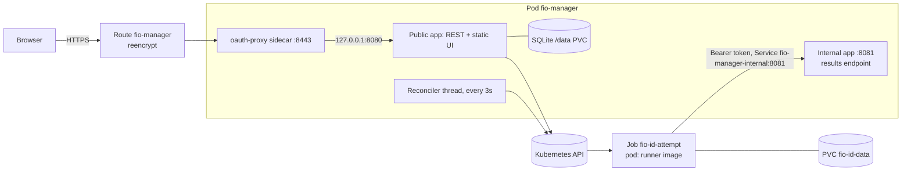
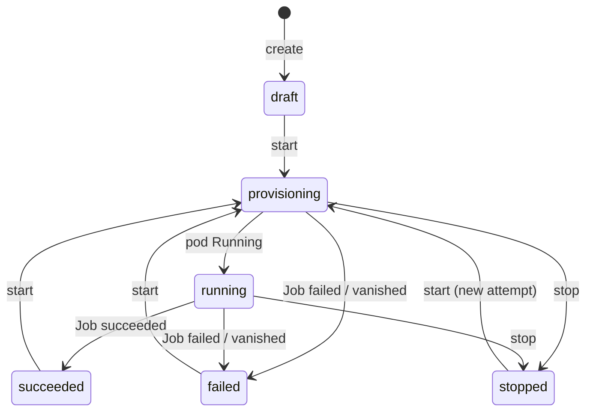

# System patterns

## Architecture

One Python process, two uvicorn servers in one asyncio loop:
- **Public app** (`127.0.0.1:8080`, only reachable through the oauth-proxy sidecar): REST API under `/api`, plus the built React UI with SPA fallback.
- **Internal app** (`0.0.0.0:8081`, Service `fio-manager-internal`): only `POST /internal/runs/{id}/results`, protected by a per-run bearer token. Runner pods call it.

## Code map (`backend/app`)
| File | Role |
|---|---|
| `config.py` | Settings from env vars (`FIO_*`). |
| `models.py` | Pydantic models: `RunSpec`, `Profile`, `Run`, `StorageClassInfo`, `ResultsPush`. Validation lives here. |
| `fio.py` | Presets, job file builder, fio JSON to summary, fio logs to time series. |
| `store.py` | SQLite persistence. Light columns for lists, blobs (`result`, `metrics`, `logs`, `token_hash`) fetched separately. |
| `kube.py` | All Kubernetes calls (StorageClasses, PVC, ConfigMap, Job, pod logs). Raises `KubeError`. |
| `manager.py` | Run lifecycle, the only place that changes run state (API calls and reconciler share it, under one lock). |
| `main.py` | FastAPI apps, error mapping, process entry point. |

API contract: `docs/api.md` (authoritative, the frontend was built against it).

## Run lifecycle

- Active states are `provisioning` and `running`. Editing, deleting and starting an active run returns 409.
- Each start increments `attempt`, uses job name `fio-<id>-<attempt>`, generates a new token (only the SHA-256 hash is stored), and clears previous results.
- The PVC `fio-<id>-data` is created once and reused across attempts. It is recreated if storage class, access mode or size changed.
- The reconciler stores a copy of the pod log when a run finishes or is stopped, so logs survive pod deletion.

## Data flow of results
1. Manager creates ConfigMap `fio-<id>-cfg` with the generated `job.fio`.
2. Runner executes fio with `--output-format=json` and 1-second averaged bw/iops/lat logs.
3. Runner pushes every 5 s `{logs}` (progress, so graphs update live) and finally `{result, logs}`.
4. Manager stores summary, raw JSON and aggregated metrics. fio per-job logs are merged: bw and iops are summed across jobs, latency is averaged.
5. Metrics shape: `{time[], read|write: {iops[], bw_mibs[], lat_us[]}}`.

## Design decisions (with reasons)
| Decision | Reason |
|---|---|
| Python FastAPI + official `kubernetes` client | Requester's choice, fast to build, little work per request. |
| SQLite on a PVC, one replica, `Recreate` strategy | Accepted by requester. Time series do not fit in ConfigMaps and pod logs vanish. |
| Runner pushes results to the manager | No need for the manager to exec into pods or read PVCs. Token per run limits the blast radius. |
| Separate internal port and Service | Keeps the oauth-proxy covering the whole UI/API, while runner pods can still reach the results endpoint. |
| oauth-proxy sidecar with SAR on `get services/fio-manager` | OpenShift-native auth, no auth code in the app. Image comes from the cluster's `openshift/oauth-proxy:v4.4` ImageStream. |
| Only allow-listed fio options, job file generated server-side | Prevents injection through free-form fio options. |
| `file_size_gi * numjobs <= 0.9 * pvc_size_gi` | Avoids filling the PVC. |
| Runner pod hardened (non-root, drop ALL caps, seccomp, no SA token) | Works under the default `restricted-v2` SCC for Filesystem mode. |
| Job `backoffLimit: 0`, `activeDeadlineSeconds = runtime + ramp + 1800` | A failed benchmark must not silently retry; a hung one is bounded. |
| NetworkPolicy on runner pods: egress only to manager `:8081` and DNS | Runners do not need anything else. Verified working (results arrived). |
| Images built in-cluster with binary BuildConfigs | Local podman VM was not running; also avoids registry setup. |
| Runner image on Fedora minimal | `fio` is not in UBI repos. Needs `fio-engine-libaio` as a separate package. |
| Block volume mode rejected by validation | Raw device access likely needs `anyuid` or privileged SCC. Deferred. |
| Run duration divided by `numjobs` in the summary | With `group_reporting`, fio sums `job_runtime` across jobs. |
| fio status line uses `\r`; manager converts to `\n` on log read | Readable logs in the UI and downloads. |

## Kubernetes resources
- Per run (label `fio-manager/run-id=<id>`, `app.kubernetes.io/managed-by=fio-manager`): PVC, ConfigMap, Job.
- Permanent: ServiceAccount, Role (PVC, ConfigMap, pods, pods/log, jobs in namespace), ClusterRole `fio-manager-storageclasses`, Deployment, 2 Services, Route, PVC `fio-manager-data` (2Gi), NetworkPolicy, ImageStreams and BuildConfigs.

## Frontend patterns (`frontend/src`)
React 18 + TypeScript + Vite, Tailwind CSS v4 with shadcn-style components in `src/components/ui/` (Radix primitives, lucide icons, fonts bundled for air-gapped use), Recharts, `react-router-dom`. Typed API client in `api.ts`, `usePolling` hook keeps previous data while refetching (no flicker). Pages: Runs, Run form (create/edit), Run detail (Overview/Logs/Graphs), Compare. Polling intervals: run list 3 s, run 2 s, logs 2 s, metrics 3 s, only while the run is active.
